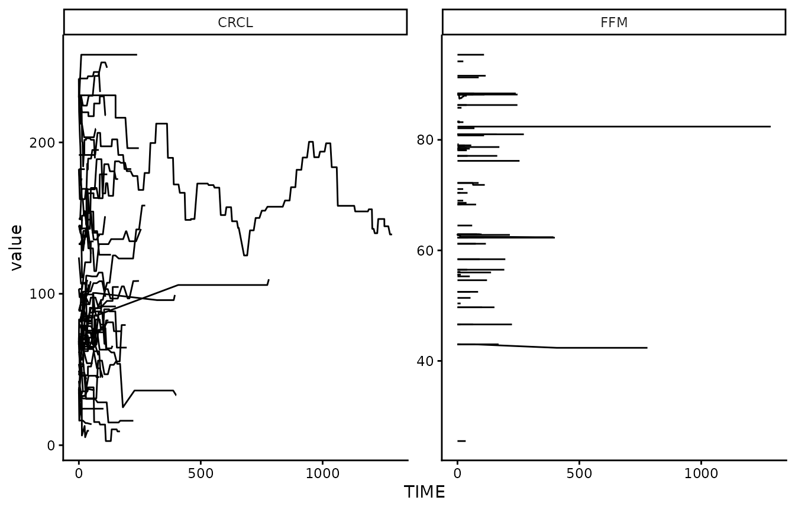
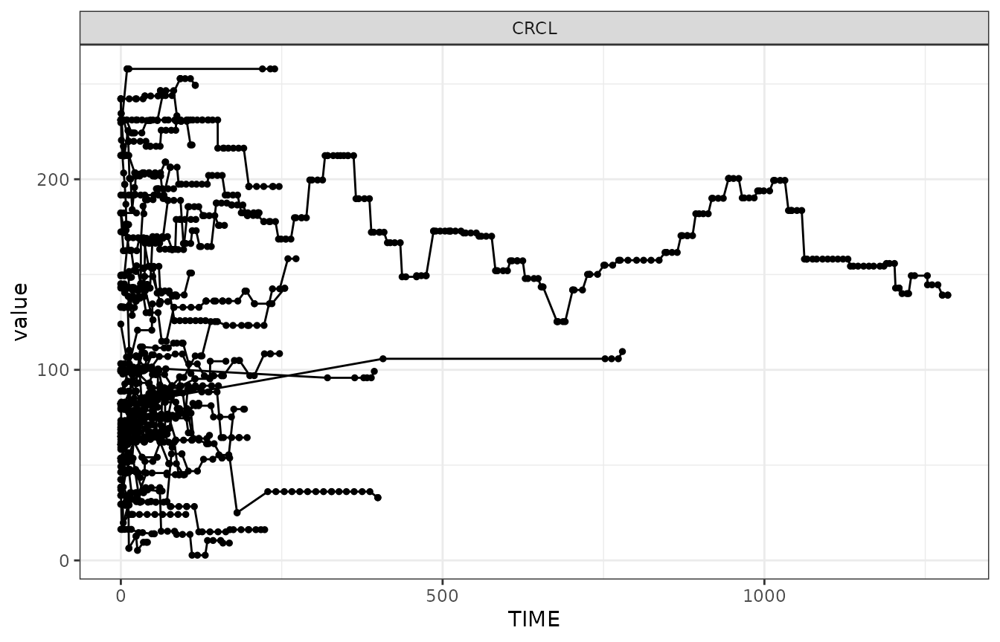
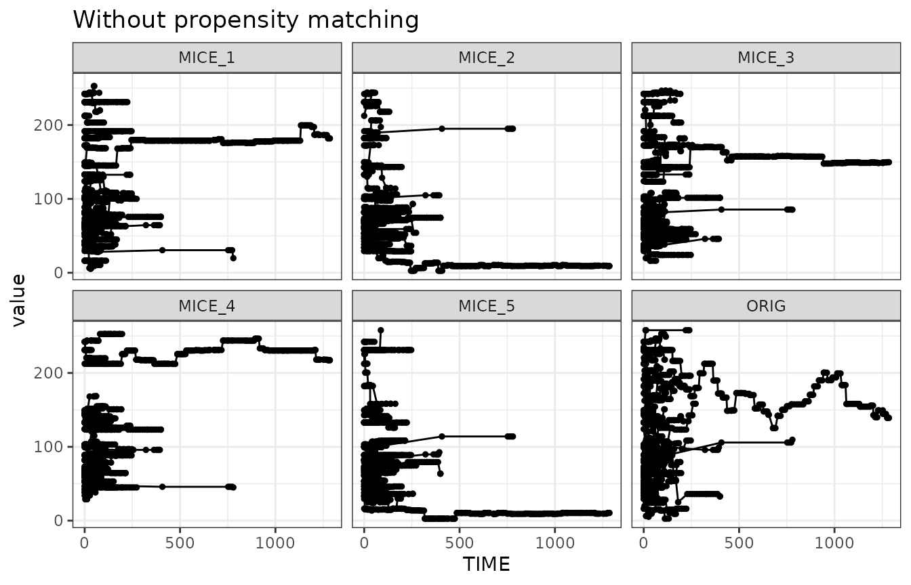
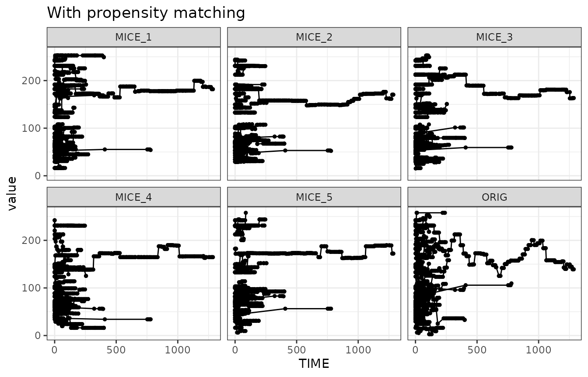
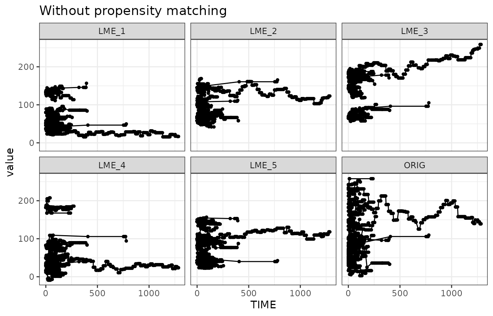
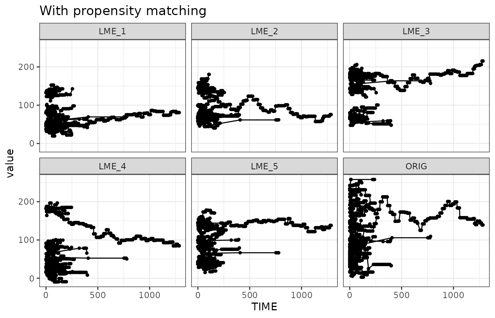
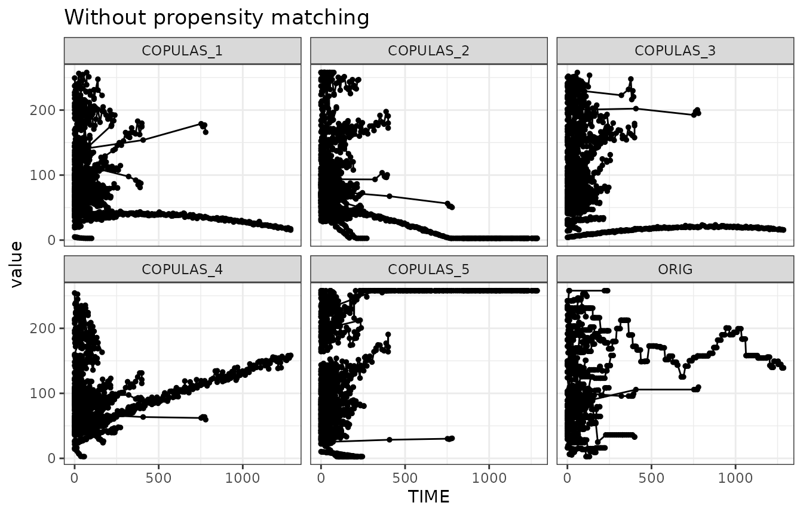
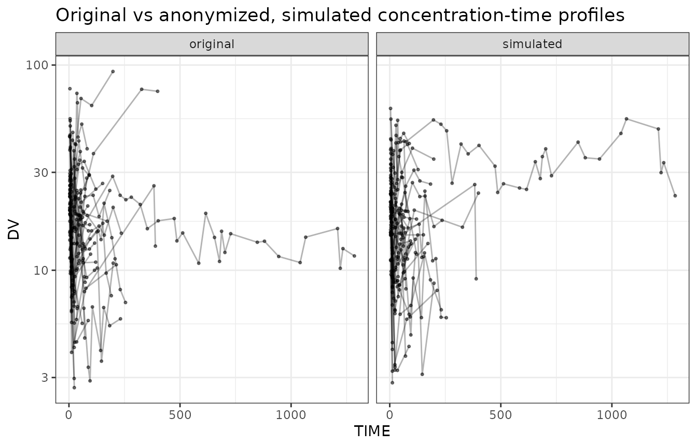
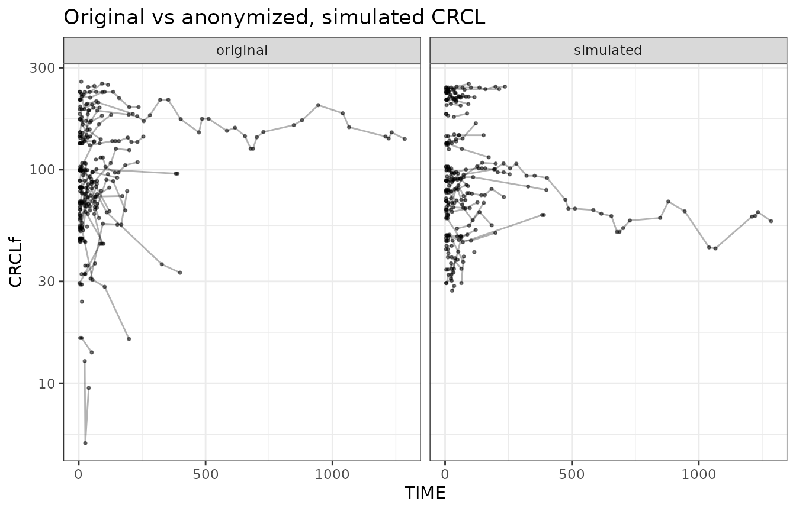

# Anonymizing pharmacokinetic modeling datasets

> Note: The example data and the FeRx model used in this vignette are
> bundled with the package under `inst/extdata` and accessed via
> [`system.file()`](https://rdrr.io/r/base/system.file.html).

## Introduction

Datasets can often not be shared, either because of privacy concerns, or
because the rights to the data are not owned. If we would be able to
anonymize the data sufficiently, however, we would be able to share them
with others. This can be useful in various ways, e.g. allowing other
researchers to reproduce models, allow testing and benchmarking for
optimization of estimation algorithms or covariate selection approaches,
or just to allow researchers to play around with certain types of
datasets that are more realistic than purely simulated datasets with
simplistic dosing/sampling designs.

## Approach

Real world pharmacokinetic modeling datasets can have various
identifying information:

- Subject ID numbers, study ID numbers, drug names, etc
- Dates of birth, or age.
- Date/time of sampling/dosing
- Covariate data (esp. when extreme)
- Concentration data

We can take the following initial steps to strip PHI pretty easily:

- Renumber ID from 1:n, so they have no relationship to any patient
  number
- Remove any unnecessary columns (those not needed for
  modeling/analysis, and not used in covariate testing)
- Simulate new drug concentration data (if we have a PK model)

We can keep the dosing and sampling scheme as-is, as these are not
considered PHI unless they can be linked to a specific subject in other
ways.

However, we would still need to have a set of covariates for each
subject, ideally matching the structure and distributions in the
original dataset. While it is fairly easy to generate samples of
covariates that mimic the multi-variate distribution of static
covariates (e.g. using multivariate normal distributions, MICE sampling,
bootstrap sampling, or copulas), drawing realistic time-varying
covariates is more challenging.

## Sampling time-varying covariates

Our general covariate sampling methods don’t allow for sampling of
time-varying covariates. Bootstrap can technically be used, but then the
time-varying values are retained exactly, and thus violating the
requirement to sample new values (if used in the context of
anonymization).

We have however several options to sample covariates, while also
retaining time-varying aspect:

1.  Sample using MICE, adapted to iteratively sample time-varying
    covariates. When covariate is time-varying, sample first the initial
    covariate sample using MICE. Then, iteratively, sample the next
    value based on the previous value and time. Keep going until all
    data points filled in.
2.  Build a simple linear mixed-effects model to describe covariate
    correlations, and correlation with time. Then simulate from this
    model.
3.  Copula sampling. For time-varying covariates we would first build
    simple linear mixed-effects models that describe their trajectories.
    In the copula sampling we then sample the model coefficients, rather
    than the actual samples, and use these to reconstruct trajectories.

All approaches are relatively easy to implement. The latter two
approaches have the benefit of generating entirely new samples, although
the drawback is that they could generate examples that are less
plausible (especially if the original dataset is small).

### MICE sampling

As an example, we’ll use a vancomycin dataset here, which has these
covariates:

    #> [1] "FFM"  "CRCL"



Let’s focus on the `CRCL` covariate, which shows the most variability
over time:



We can show that with the timevarying-MICE sampling approach
([`sample_covariates_mice_timevarying()`](https://insightrx.github.io/irxforge/reference/sample_covariates_mice_timevarying.md))
we can sample covariate profiles that look similar to the one seen in
the original dataset. We show here 5 simulated example draws, and the
original in the bottom-right corner.



When we don’t use any propensity matching, however, we can see that some
of the profiles may be unexpected. It could be that some profiles are
less realistic due to the fact that they don’t match the dosing or
sampling designs anymore. Therefore it would be good to apply
propensity-score matching for the covariates for which it is relevant.
This would lead to the following example draws:



### Linear model-based covariate simulation

One drawback of the MICE-based sampling of covariates is that no purely
new covariate values can be generated. In contrast to the bootstrap, it
does let go of the constraint of sampling entire covariate sets
per-subject, but still it can only sample covariate values it has seen
in the dataset. So theoretically, especially with the propensity-score
activated, it could be argued the “anonymization” is not sufficient
using MICE, as it could actually be that the same “drawn” covariates are
matched to the original subject, especially when using propensity-score
matching.

An alternative is to build a simple LME model for the covariate
distributions, that also takes time into account. When simulating based
on such a model, only new covariate values are drawn, ensuring a fuller
anonymization. Also in this approach, applying propensity-score matching
is useful, to ensure optimal realism in the new dataset.



## Copulas

Sampling covariates can also be done using copulas. Time-varyingness can
be achieved by fitting a simple time-based model to the data, and then
sampling the model coefficients using copulas rather than the actual
values (Zwep et al. CPT-PSP 2023). We’ll also add some noise (4%) to the
data, otherwise the trajectories are very static. This section requires
the `rvinecopulib` package.



The timevarying nature of the simulated data looks a bit less like the
original data now, compared to either MICE or LME methods.

Overall, the data sampled with timevarying-MICE, with propensity-score
matching, most resembles the original data.

## Last step: concentration simulation

Now that we have an approach to perform the sampling of time-varying
covariates while maintaining realism in the time-varying aspects, we can
perform the last step in this process: the simulation of the
concentration-time curves.

Again, to improve realism in the simulation, we could do another
propensity-score matching step based on draws (etas) from the omega
matrix. However, that would then destroy the matching we just did for
the covariates. If the original dataset contained much
treatment-adaptation, this may however warrant further consideration.
One approach could be to also draw eta’s before the
covariate-propensity-matching is done, and match on both the relevant
covariates as well as the relevant ETAs. But for most cases this may be
overkill, and we’ll leave that out of the generic functions for now.

## Putting it all together: anonymize_dataset() function

The function
[`anonymize_dataset()`](https://insightrx.github.io/irxforge/reference/anonymize_dataset.md)
combines all steps described above: the simple data cleaning, the
sampling of (time-varying) covariates, and the simulation of
concentration data. A single call can now generate a new dataset.

The vancomycin model (`vanco_model.ferx`) drives clearance off `CRCLf`
and the volumes off `FFM`, so those are the covariates we sample and
anonymize. The structural columns (`ID`, `EVID`, `AMT`, `TIME`, `DV`,
`RATE`) already use their default names in this dataset, so the default
`dictionary` applies.

One additional step aims to improve the realism of the simulated data
further: we draw 10 candidate covariate sets and keep the one whose
simulated concentration data most closely resembles the original, judged
by a score that computes the deviance from the original data. This score
can be based on the covariates, the simulated concentrations, or both.

Additionally, we round both the covariate data and the simulated
concentration to 4 significant digits, and drop below-LOQ observations.

The simulation step requires the `ferx` package to simulate
concentrations.

``` r

model_file <- system.file("extdata", "vanco_model.ferx", package = "irxforge")
anon <- anonymize_dataset(
  data         = csv,
  method = "lme",
  covariates   = c("FFM", "CRCLf"), 
  model_file   = model_file,
  dictionary   = list(
    ID = "ID", EVID = "EVID", AMT = "AMT",
    TIME = "TIME", DV = "DV", RATE = "RATE"
  ),
  n_candidates = 10,              # draw 10 candidates, keep the closest to the original
  score_on     = "concentration", # score each candidate on its simulated concentrations
  sigdig       = 4,               # round covariates and simulated concentrations
  loq          = 2.0,             # vancomycin LOQ (mg/L)
  blq_method   = "remove",        # drop below-LOQ observation rows
  seed         = 26
)
head(anon)
#>   ID    TIME EVID  AMT RATE    DV MDV  FFM CRCLf
#> 1  1  0.0000    1 1750 1000  0.00   1 62.8 65.04
#> 2  1  6.6167    0    0    0 15.13   0 62.8 65.04
#> 3  1 10.1000    2    0    0  0.00   1 62.8 73.74
#> 4  1 10.2000    1 1750 1000  0.00   1 62.8 73.74
#> 5  1 20.3833    2    0    0  0.00   1 62.8 72.98
#> 6  1 23.8000    2    0    0  0.00   1 62.8 75.09

# How close the selected candidate was to the original (lower = closer)
attr(anon, "similarity_score")
#> [1] 0.007480446
```

The result is a ready-to-share pharmacometric dataset: IDs renumbered
`1:n`, identifying columns dropped, covariates resampled (and rounded),
and concentrations re-simulated from the model.

``` r

bind_rows(
  csv |> mutate(source = "original"),
  anon |> mutate(source = "simulated")
) |>
  filter(EVID == 0) |>
  ggplot(aes(x = TIME, y = DV, group = ID)) +
    geom_line(alpha = 0.3) +
    geom_point(size = 0.6, alpha = 0.5) +
    scale_y_log10() +
    theme_bw() +
    facet_wrap(~source) +
    ggtitle("Original vs anonymized, simulated concentration-time profiles")
```



The covariate distribution of CRCLf in this run looked like this:



## Disclaimer

As you may have guessed, the initial dataset used in this example was
itself also an anonymized copy of a real dataset…
